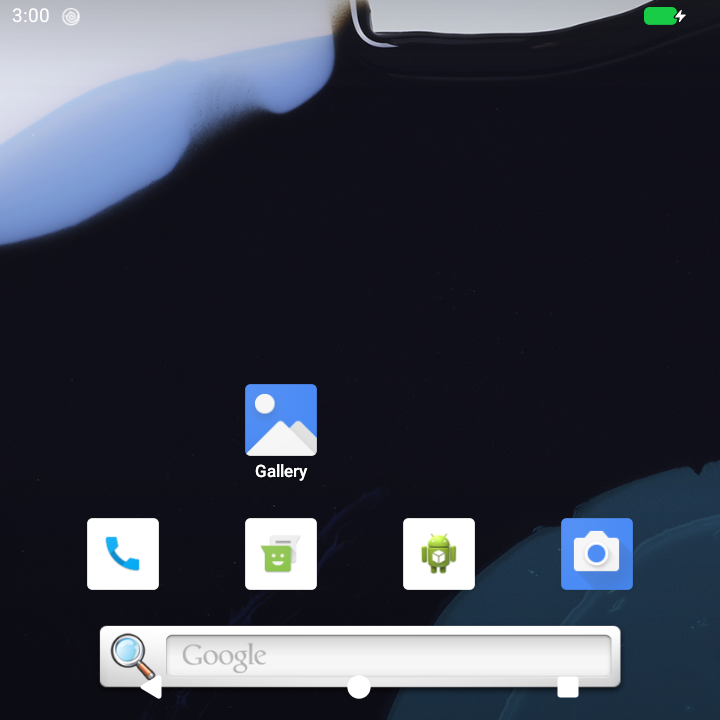
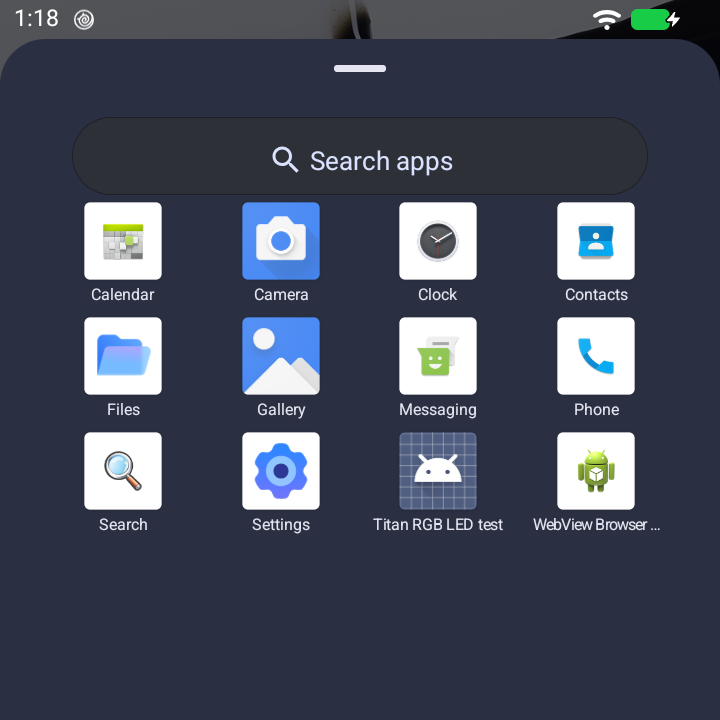
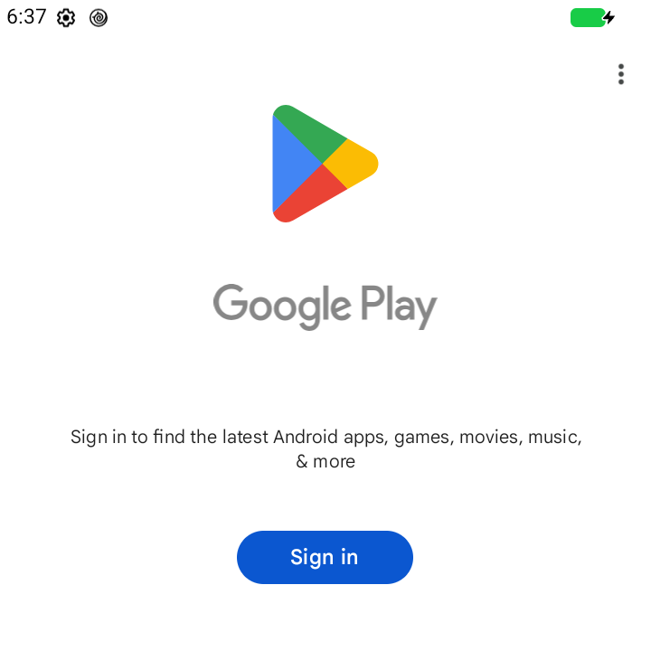

# Android 17 on the Unihertz Titan Pocket

I wanted to keep using the Titan Pocket's physical keyboard without staying on its old Android release. Getting Android 17 to boot turned out to be the start of the work. The keyboard needed its symbols back. The keyboard surface needed to scroll without a mouse cursor. Lights, fingerprint support and the square-screen layout all needed attention too.

The first Android 17 image that worked for me was a Restless GSI. Google's September preview took more work: we tested compatibility changes in a DSU guest before moving to a permanent install. This repo contains the source patches, build recipes and test findings from that process.

The test phone now boots `CP3A.260905.010` directly, without a guest ROM. It still uses the stock MediaTek Linux 4.14 kernel and vendor drivers. This is an unofficial port for the **Titan Pocket**, with work still needed before I can call it a daily driver.

## Start here

- **Understand the port:** read the [phone tests](#phone-tests) below, then the [hardware source map](hardware/README.md).
- **Run tests or build components:** follow the [build and usage guide](docs/BUILDING.md). The host tests can run without a phone or firmware.
- **Rebuild the current app layer:** use the [base-app recipe](hardware/base-apps/README.md). It requires an already-patched, exact-match SYSTEM image and private inputs.
- **Install on another phone:** there is no public flashable release or general-purpose installer in this repo. The recipes produce offline candidates; cloning this repo is not enough to reproduce the installed phone.

Firmware, APKs, signing keys, original compiled Android components and private device logs are excluded. Some build inputs still depend on the original development environment. Those limits are described in the guide.

## Screenshots

These are real captures from the work, before the final base-app update. They show earlier stages, not the exact current app selection. The images contain no account details.

| Android 17 guest home screen | Android 17 guest app drawer | Play Store's first launch on the permanent install |
|---|---|---|
|  |  |  |

The home screen predates the navigation-bar removal and still has the old search widget. The drawer still shows the old camera, Search and test browser. The current base removes those apps and includes GrapheneOS Camera and Ungoogled Chromium. The Play Store capture shows its sign-in screen; it does not prove account sign-in or app downloads. [Capture details](docs/BUILDING.md#screenshot-provenance).

## Phone tests

These results come from one test phone. Guest checks and permanent-install checks are listed separately so you can see what still needs repeating.

| Area | What we checked |
|---|---|
| Boot | Permanent September build boots with SELinux Enforcing and encrypted userdata. Full SUPER, BOOT, recovery and vbmeta readback hashes matched at installation; a normal reboot passed. |
| Keyboard | First-unlock surface scrolling, normal typing, Alt+A for `@` and keyboard-light timeout passed owner checks on the permanent install. In the guest, scrolling also survived two lock/wake cycles, worked alongside touchscreen scrolling and showed no mouse cursor. Physical PIN entry passed earlier testing. |
| Navigation and screen | Physical navigation keys worked in the guest, with Android's on-screen bar removed through a resource overlay. Display density is 260 on the permanent install. Guest tests covered the enlarged boot animation and keyboard/button lights turning off with the screen. |
| Fingerprint, Bluetooth and LED | Fingerprint enrollment/unlock, Bluetooth music and the green notification LED passed earlier guest checks. Fresh enrollment, pairing and hardware rechecks are still needed after a clean install. |
| Camera | GrapheneOS Camera 93 is built into SYSTEM, and photo/video capture intents resolve to it. AOSP Camera2, Camera Go and BSG are absent. Capture quality remains unverified. |
| Browser and WebView | Ungoogled Chromium 155 is the default browser. Cromite WebView 153 prepared both ARM32 and ARM64 providers. Actual page rendering after the final update remains unverified. These are pinned builds, not a promise of current browser security. |
| Cellular | No SIM was available. Modem detection does not establish working carrier calls, SMS, mobile data or VoLTE. |
| Still to test | Photo/video/flash, BLE, call audio, other LED colors, sensors in use, battery endurance, remaining permanent-install hardware checks, factory reset and a full stock restore. |

The touchpad initially made touchscreen scrolling and animations slower. Profiling found repeated `/proc/self/maps` parsing on the live input thread. The fix keeps those scans out of the live checks, and the owner reported that the phone felt much faster. A later profile no longer showed memory-map parsing above the 1% report threshold. The two profiles used different input activity, so they do not establish a percentage speedup.

The detailed recorded results and output hashes are in [verification.json](verification.json). They describe checks from the porting work; they are not a fresh test run on every clone.

## What remains stock

The newer Android system depends on the old kernel and proprietary vendor support. Replacing SYSTEM does **not** patch the kernel and vendor vulnerabilities discovered since their release. This is not a mainline-kernel port or official Unihertz firmware.

The permanent installation erased the test phone's apps and settings with the owner's consent. Stock firmware backups exist, but a full stock userdata backup was waived before erasure. NVRAM, proinfo, TEE, bootloader and DTBO raw hashes matched their pre-install values. Four writable vendor-data partitions changed raw hashes while mounted; individual calibration files have not been compared.

An unlocked bootloader and custom system can fail app integrity checks. **Do not relock the bootloader with this port.** Relocking has not been tested. The [usage guide](docs/BUILDING.md#installation-and-recovery-boundary) explains what is missing from a repeatable installation and recovery path.

## Build and test

With Python 3, Clang with C++20 and sanitizer support, and JDK 17 on your PATH, run from the repo root:

```sh
python3 tools/test.py --output build/core
python3 tools/test.py --output build/core-tsan --sanitizer thread
python3 tools/test_keyguard.py --output build/keyguard
```

These commands test host-side input ownership, session state and the first-unlock regression. They do not connect to the phone. See the [build and usage guide](docs/BUILDING.md) for tool checks, expected results, private-input setup and component builds.

## Other hardware sources

The [hardware source map](hardware/README.md) covers boot compatibility, keyboard layout, PIN entry, lighting, fingerprint, Bluetooth, navigation and UI spacing. Many directories record pinned experiments from the guest stage. They are not a sequence of scripts to run on your phone.

The [current base-app recipe](hardware/base-apps/README.md) integrates GrapheneOS Camera, Ungoogled Chromium, mixed-ABI Cromite WebView and the touchpad performance fix. The [earlier camera add-on](hardware/system-camera/README.md) is retained for the previous base image and is superseded on the current image.

For a bug report, include your build ID, whether it is a guest or permanent install, the affected feature and steps to reproduce it. Remove serial numbers, account details and personal content from any logs or screenshots.

Upstream notices and the limits on reuse are in [THIRD_PARTY.md](THIRD_PARTY.md). No project-wide license has been chosen for the remaining code.
